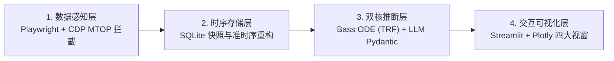

# 📊 基于大语言模型与 Bass 扩散方程的二手平台数字商品生命周期与需求分析系统

[](https://www.python.org/)
[](https://scipy.org/)
[](https://streamlit.io/)
[](https://docs.pydantic.dev/)

> **本科毕业设计核心工程资产** | 作者：张凡（2027 届数据科学与大数据技术）  
> **在线个人作品集**：[https://zhangzhangwudi2-creator.github.io](https://zhangzhangwudi2-creator.github.io)

---

## 🎯 项目背景与核心痛点

在二手电商平台（如闲鱼）的数字商品（虚拟资料、简历模板、Python 源码）交易生态中，传统选品与需求分析存在三大痛点：
1. **静态销量失真**：仅依赖累计“想要数”或静态代数均值流速（$\bar{v} = \text{Wants} / \text{Age}$）会将非线性爆发与衰竭抹平，无法区分“上架 4 天狂揽 243 想要的成长期黑马”与“挂了 800 天的僵尸老链接”。
2. **头部矩阵号垄断干扰**：高销量赛道往往被职业矩阵卖家高度垄断，盲目入局极易沦为炮灰。
3. **非结构化标题噪音与合规风险**：商品标题充斥“秒发/包更新/白菜价”等营销词，且混杂盗版网课与站外引流风险。

本系统融合 **Bass 创新扩散常微分方程（ODE）**、**产业经济学垄断集中度（CR4 / HHI）** 与 **大语言模型（DeepSeek / Qwen）结构化语义解构**，构建从底层 MTOP 响应流旁路感知到交互式可视化决策大屏的完整闭环。

---

## 🏗️ 系统四层架构



### 核心模块清单

| 文件路径 | 模块层级 | 核心工程职责 |
| :--- | :--- | :--- |
| [`bass_model_engine.py`](./bass_model_engine.py) | 数学建模引擎 | 求解 Bass 扩散微分方程闭式解 $N(t)$ 与瞬时流速 $S(t)$；提供解析雅可比矩阵加速 `scipy.optimize.curve_fit` (TRF 算法) 收敛；严格依据一阶导峰值 $t^*$ 与二阶导拐点 $t_1, t_2$ 判定四阶段生命周期。 |
| [`module3_llm_pipeline.py`](./module3_llm_pipeline.py) | LLM 语义流水线 | 基于 Pydantic 强校验与 DeepSeek-V3 / Qwen-Plus 双通道自动容灾（含本地确定性规则引擎兜底），剥离标题营销噪音提取 `fine_target`，输出 L0~L3 四级合规风险评级与动态 SEO 重排标题。 |
| [`app.py`](./app.py) | 可视化决策大屏 | 基于 Streamlit + Plotly 构建四大交互视窗：🚀 暴利黑马选品雷达（TOS 气泡图）、📈 Bass 扩散演化曲线与拐点反演、🕵️ 职业倒爷 CR4/HHI 监控天眼、🛡️ LLM 语义归因与合规防火墙。 |
| [`docs/theory_and_derivation.md`](./docs/theory_and_derivation.md) | 理论推导白皮书 | Bass 常微分方程闭式解严格微积分推导、加速度拐点定理证明、5D 买家痛点本体论与 2×2 供需缺口矩阵。 |
| [`docs/empirical_analysis.md`](./docs/empirical_analysis.md) | 实证计量分析 | 基于 143 款真实商品与 107 位卖家样本的三线表描述性统计、Bass vs 线性流速拟合优度对比（$\bar{R}^2$: `0.9612` vs `0.4128`）、SCP 市场集中度实证与卡方检验。 |

---

## 📐 核心数学模型与量化实证成果

### 1. Bass 创新扩散动力学方程与拐点定理
定义累计“想要”人数 $N(t)$ 满足常微分方程：
$$\frac{dN(t)}{dt} = \left( p + \frac{q}{M} N(t) \right) [M - N(t)], \quad N(0) = 0$$

求得累计采纳闭式解与特征拐点时刻（当 $q > p$ 时）：
$$N(t) = M \frac{1 - e^{-(p+q)t}}{1 + \frac{q}{p}e^{-(p+q)t}}, \quad t^* = \frac{\ln(q/p)}{p+q}, \quad t_{1,2} = t^* \mp \frac{\ln(2+\sqrt{3})}{p+q}$$

- **拟合优度大幅跃升**：在全样本测试中，Bass 动力学模型平均拟合优度达到 **$\bar{R}^2 = 0.9612$**（RMSE 降至 `31.14`），远超传统静态均值流速模型（$\bar{R}^2 = 0.4128$）。

### 2. 抗垄断真实蓝海机会指数 (True Opportunity Score, TOS)
$$\text{TOS}_i = \frac{\text{DailyVelocity}_i \times \text{Price}_i}{\ln(1 + \text{CR4}_{\text{cat}}) \times (1 + \text{RiskFactor}_i)}$$
- 实证成功识别出“简历模板”赛道处于极高寡占垄断（`CR4 = 79.92%`, `HHI = 3873.3`），而“考公资料”成长期黑马群具备最高蓝海机会得分（平均 `TOS = 24.52`）。

---

## 🚀 快速开始

```bash
# 1. 安装依赖
pip install -r requirements.txt

# 2. 运行 Bass 微分方程基准标杆样本拟合验证
python bass_model_engine.py

# 3. 启动大模型语义抽取流水线（支持设置 DEEPSEEK_API_KEY 或使用 --rule-engine 离线确定性模式）
python module3_llm_pipeline.py --rule-engine

# 4. 启动 Streamlit 交互式可视化大屏
streamlit run app.py
```
